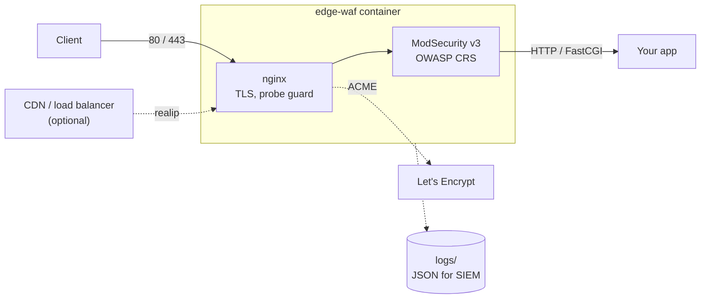

# edge-waf

[](https://github.com/Fidelir/edge-waf/actions/workflows/ci.yml)
[](LICENSE)

A self-hosted web application firewall in one container for a single host or a small fleet. It takes the place of
nginx and certbot in front of your applications: **nginx** terminates HTTP/TLS with certificates it obtains and renews
itself, **ModSecurity v3** with the **OWASP Core Rule Set (CRS)** inspects requests and responses, and traffic is
proxied to your application. Sites are plain nginx `server` blocks; you own the configuration, certificates and logs.



## What you get

Out of the box, with the site templates from [examples/](examples):

- **A WAF you can roll out safely.** ModSecurity v3 with OWASP CRS
  ([anomaly scoring](https://coreruleset.org/docs/2-how-crs-works/2-1-anomaly_scoring/),
  [paranoia levels 1–4](https://coreruleset.org/docs/2-how-crs-works/2-2-paranoia_levels/)) starts in
  `DetectionOnly`: it logs what it would block until you [enable blocking](#enable-blocking), globally or per site.
  JSON, XML and multipart request bodies are parsed and inspected; HTML and text responses are checked for leaks such
  as SQL errors and stack traces. Settings are validated at start: a typo stops the container with a clear message
  instead of running with a wrong value.
- **Automatic HTTPS.** One line in a site config, and nginx requests and renews its Let's Encrypt certificate with the
  official [ngx_http_acme_module](https://nginx.org/en/docs/http/ngx_http_acme_module.html). No certbot, cron jobs or
  reloads ([details](#automatic-https)).
- **Logs ready for a SIEM.** A JSON access log with about 40 fields (client and peer address, upstream timings, TLS
  version, probe guard decisions) and a JSON audit log of requests that matched rules, joined by one `request_id`
  that also reaches your application. Successful requests for static assets are not logged ([details](#logs)).
- **Nothing to find by IP.** Requests for unknown host names are closed without a response, and TLS handshakes without
  a known server name are rejected: scanners that sweep IP addresses reach no application and cannot read your site
  names from a certificate.
- **Slow clients are dropped.** A client that trickles its request header (Slowloris) is cut off after 10 s; body
  reads and response writes time out after 30 s without progress, idle keep-alive connections after 30 s, and
  timed-out connections are reset. Request bodies are limited to 25 MB, header lines to 16 KB.
- **Scanner noise stops early.** The [probe guard](docs/tuning.md#probe-guard) answers 403 to `/.env`, `/.git/`,
  `wp-login.php`, path traversal and known scanner user agents before ModSecurity runs, and logs each hit.
- **Modern TLS.** TLS 1.2 and 1.3 with forward-secret AEAD ciphers only, no session tickets, HTTP/2. Clients that
  support it, such as current browsers, get the hybrid post-quantum key exchange `X25519MLKEM768`; others fall back
  to X25519 or P-256.
- **Less to fingerprint.** The nginx version and upstream headers such as `Server`, `X-Powered-By` and
  `X-AspNet-Version` are not sent to clients.
- **Proxying done right.** Applications get the client address in `X-Real-IP` and `X-Forwarded-For` (replaced, not
  appended, so a forged header never reaches them), the request ID in `X-Request-ID`, and working WebSockets.
  Upstream responses arrive uncompressed so that ModSecurity can inspect them; nginx compresses them for the client.
- **A build you can verify.** Sources are checked against pinned SHA-256 sums; nginx is compiled as PIE with stack
  protection, `FORTIFY_SOURCE` and full RELRO; workers run unprivileged; releases carry SBOM and provenance
  attestations; Trivy scans every change and runs weekly ([details](#image)).
- **Tested end to end.** On every change CI runs the [quick start](#quick-start), automatic HTTPS against
  [Pebble](https://github.com/letsencrypt/pebble) (the Let's Encrypt test CA) including a site added by reload,
  `nginx -t` for every example, and smoke tests of the WAF, the probe guard and the logs.

Component versions: [CHANGELOG.md](CHANGELOG.md).

## What it is not

- Not a CDN, DDoS protection or rate limiting service. Volumetric attacks must be absorbed upstream.
- Not bot management: no JavaScript challenges, fingerprinting or CAPTCHA.
- Not a substitute for patching your application. CRS reduces risk; it has false negatives and false positives.
- Not a managed service: rules come from CRS releases, there is no SLA.

## Quick start

Requirements: Linux with Docker Engine and Compose v2, ports 80 and 443 free, and an application on `127.0.0.1:8080`
(no app yet? `docker run -d --name demo-app -p 127.0.0.1:8080:80 nginx:stable-alpine`).
On Docker Desktop (macOS, Windows) use [bridge mode](#network-modes).

```bash
git clone https://github.com/Fidelir/edge-waf.git && cd edge-waf
cp examples/quickstart-http.conf conf.d/quickstart.conf
docker compose pull          # or build locally: docker compose build (about 10 minutes)
docker compose up -d

curl -i http://localhost/                                    # 200 from your app
curl -i http://localhost/.env                                # 403 from the probe guard
curl -i "http://localhost/?id=1%27%20OR%20%271%27%3D%271"    # SQL injection: passes, but is logged
tail -n 1 logs/modsec_audit.log
```

CI runs these steps on every change (`tests/quickstart.sh`).

The first run uses `MODSECURITY_ENGINE=DetectionOnly`: ModSecurity logs what it would block and blocks nothing, so a
false positive cannot take your site down on day one. When the logs are clean, [enable blocking](#enable-blocking).

Next steps: a real domain with [automatic HTTPS](#automatic-https), the [network mode](#network-modes) that fits your
host, and the [real client IP](#real-client-ip) if you are behind a CDN.

## Network modes

| Mode | Compose file | Use when | Upstream address in `proxy_pass` |
|---|---|---|---|
| Host (default) | `docker-compose.yml` | Linux with Docker Engine | `127.0.0.1:PORT` |
| Bridge | `docker-compose.bridge.yml` | Docker Desktop, or the WAF must not share the host network | `host.docker.internal:PORT`, or a container name on a shared network |

```bash
docker compose up -d                                  # host
docker compose -f docker-compose.bridge.yml up -d     # bridge
```

**Host mode.** nginx binds directly on the host, so ports 80, 443 and `127.0.0.1:8099` (`WAF_HEALTH_PORT`) must be
free, and nginx sees real client addresses over IPv4 and IPv6. Make apps reachable only through the WAF: bind them to
`127.0.0.1` and publish app containers as `-p 127.0.0.1:8080:80`. A port published on all interfaces is reachable from
the internet past the WAF, and Docker's iptables rules bypass ufw.

**Bridge mode.** Docker publishes `WAF_HTTP_PORT` / `WAF_HTTPS_PORT` (default 80 / 443). Put
`COMPOSE_FILE=docker-compose.bridge.yml` in `.env` so that plain `docker compose` commands use it, and change the
upstreams in the examples to `host.docker.internal:PORT` or a container name. `502 Bad Gateway` means the WAF cannot
reach the upstream: an app bound to `127.0.0.1` on the host is not reachable from a bridge container. Connections that
Docker forwards through its userland proxy (for example IPv6 clients on an IPv4-only network) reach nginx from the
Docker gateway address instead of the client address. On Docker Desktop, host mode binds inside the Docker VM, not on
your machine; use bridge mode there.

**IPv6.** `conf.d/default.conf` and the examples also listen on `[::]`. If IPv6 is disabled in the host kernel, nginx
fails to start with `Address family not supported by protocol`: remove the `listen [::]` lines.

## Configuration

Environment variables (set them in `.env` next to the compose file or in the shell):

| Variable | Default | Meaning |
|---|---|---|
| `MODSECURITY_ENGINE` | `DetectionOnly` | `DetectionOnly` logs only, `On` blocks, `Off` disables rule processing |
| `CRS_PARANOIA_LEVEL` | `1` | CRS paranoia level 1–4; higher detects more and produces more false positives |
| `CRS_INBOUND_ANOMALY_THRESHOLD` | `5` | Request anomaly score that triggers blocking (5 = one critical rule) |
| `CRS_OUTBOUND_ANOMALY_THRESHOLD` | `4` | Response anomaly score that triggers blocking |
| `WAF_HEALTH_PORT` | `8099` | Port of the `/healthz` endpoint on `127.0.0.1`, used by the container HEALTHCHECK; in host mode it is opened on the host |
| `ACME_EMAIL` | empty | Contact address registered with Let's Encrypt (optional) |
| `WAF_RESOLVER` | from `/etc/resolv.conf` | DNS servers nginx uses for ACME and runtime name resolution, space-separated |
| `WAF_IMAGE` | `ghcr.io/fidelir/edge-waf:0.1.1` | Image used by the compose files |
| `WAF_HTTP_PORT`, `WAF_HTTPS_PORT` | `80`, `443` | Published ports, bridge mode only |

Mounted from the project directory:

| Path | In container | Content |
|---|---|---|
| `conf.d/` | `/etc/nginx/conf.d` | Sites (`server` blocks) and http-level snippets such as realip |
| `ssl.d/` | `/etc/nginx/ssl.d` | Your own certificates: `ssl.d/<domain>/fullchain.pem`, `privkey.pem` |
| `acme/` | `/var/lib/nginx/acme` | Automatic HTTPS state: ACME account keys, issued certificates and their private keys |
| `logs/` | `/var/log/nginx` | `access.log`, `error.log`, `modsec_audit.log` |

`nginx/` and `modsecurity/` are baked into the image; rebuild after changing them.

## Sites

Copy an example into `conf.d/`, edit `server_name`, certificates and the upstream, then reload without downtime:

```bash
docker compose exec waf nginx -t && docker compose exec waf nginx -s reload
```

| Example | For |
|---|---|
| [quickstart-http.conf](examples/quickstart-http.conf) | First run on `http://localhost/` |
| [auto-https.conf](examples/auto-https.conf) | Any HTTP app with an automatic Let's Encrypt certificate |
| [reverse-proxy.conf](examples/reverse-proxy.conf) | Any HTTP app with your own certificate files |
| [static-site.conf](examples/static-site.conf) | Static files served by the WAF container |
| [php-fpm.conf](examples/php-fpm.conf) | PHP-FPM application with a front controller |
| [api-json.conf](examples/api-json.conf) | JSON API with JSON error bodies |
| [realip-cloudflare.conf](examples/realip-cloudflare.conf) | Behind Cloudflare |
| [realip-proxy.conf](examples/realip-proxy.conf) | Behind a load balancer that sets `X-Forwarded-For` |

Upstreams in the examples use host mode addresses (`127.0.0.1`).

`include snippets/deny-probes.conf;` at server level answers 403 to scanner probes before any `location` runs. It also
rejects paths that some applications use legitimately: `*.php` (apps without a front controller, WordPress), `*.aspx`,
`/graphql`, `/api/swagger`, `/api/openapi`. Check the [full list](docs/tuning.md#probe-guard) before enabling it for
such an app. `snippets/deny-empty-ua.conf` additionally rejects requests without a `User-Agent`, except from addresses
in `nginx/monitor-ips.conf`; it is opt-in because many API clients send no `User-Agent`.

## Automatic HTTPS

[examples/auto-https.conf](examples/auto-https.conf) shows the whole site. The TLS part is:

```nginx
acme_certificate       letsencrypt;            # names are taken from server_name
ssl_certificate        $acme_certificate;
ssl_certificate_key    $acme_certificate_key;
ssl_certificate_cache  max=2;
```

nginx requests the certificate on start and on reload, answers the HTTP-01 challenge on port 80 itself (before
redirects, the probe guard and ModSecurity), and renews the certificate before it expires, using ACME Renewal
Information when the CA offers it. Requirements:

- DNS for every name in `server_name` points to this host and port 80 is reachable from the internet. Wildcards and
  regular expressions in `server_name` cannot be used for certificates.
- `acme/` is mounted (both compose files do this) so that account keys and certificates survive container
  re-creation. Without it, every image update or `docker compose up -d` after a change issues new certificates and
  soon runs into Let's Encrypt [rate limits](https://letsencrypt.org/docs/rate-limits/).

Two issuers are predefined: `letsencrypt` and `letsencrypt_staging`. Staging certificates are not trusted by browsers,
but its rate limits are much higher; use it until the site works, then switch and reload. Using either issuer accepts
the Let's Encrypt [Subscriber Agreement](https://letsencrypt.org/repository/). Another CA (ZeroSSL, a company CA) is
added as an `acme_issuer` block in an http-level file in `conf.d/`, with `state_path` under `/var/lib/nginx/acme/`; see
the [module documentation](https://nginx.org/en/docs/http/ngx_http_acme_module.html).

Until the first certificate arrives (usually seconds), HTTPS handshakes for the site fail and `logs/error.log` shows
`cannot load certificate "/etc/nginx/"`; this is expected. If it does not stop, look for ACME errors in the same log:
DNS that points elsewhere and a closed port 80 are the usual causes. `acme/` contains private keys: keep it out of
backups that others can read.

## Enable blocking

1. Run in `DetectionOnly` with real traffic for a few days.
2. Review what would have been blocked: `logs/modsec_audit.log`, and `ModSecurity: Warning` lines in `logs/error.log`.
3. Remove false positives per site ([docs/tuning.md](docs/tuning.md)).
4. Switch globally with `MODSECURITY_ENGINE=On` and `docker compose up -d`, or per site with
   `modsecurity_rules 'SecRuleEngine On';` in its `server` block.

## Real client IP

By default the client address is the TCP peer and forwarding headers are not trusted. Behind a CDN or a load balancer,
copy one of the realip examples to `conf.d/00-realip.conf`:

- Cloudflare: [examples/realip-cloudflare.conf](examples/realip-cloudflare.conf) trusts `CF-Connecting-IP` only from
  [Cloudflare ranges](https://www.cloudflare.com/ips/) (refresh with `scripts/update-cloudflare-ips.sh`).
- Other proxies: [examples/realip-proxy.conf](examples/realip-proxy.conf) trusts `X-Forwarded-For` from the networks you list.

The real address is then used in logs (`client_ip`), by ModSecurity and by `monitor-ips.conf`; the proxy address stays
in `peer_ip`.

## Logs

| File | Content |
|---|---|
| `logs/access.log` | One JSON object per request, format `waf_json` |
| `logs/error.log` | nginx errors (`warn`+); ModSecurity warnings and `Access denied` lines |
| `logs/modsec_audit.log` | ModSecurity JSON audit log: requests that matched rules or ended with 4xx (except 404) / 5xx |

`request_id` in `access.log` equals `transaction.unique_id` in the audit log. Field reference, rotation and examples:
[docs/logging.md](docs/logging.md). Without the `logs/` mount, all three go to the container output (`docker logs`).

## Image

- Multi-stage build: sources are downloaded over HTTPS and checked against pinned SHA-256 sums; the runtime stage is
  `debian:trixie-slim` with only the shared libraries nginx needs. Workers run as `nginx` (uid 101).
- `HEALTHCHECK` calls `/healthz` on `127.0.0.1:${WAF_HEALTH_PORT}`; `docker ps` shows `healthy` once nginx serves requests.
- `.dockerignore` is an allowlist: only `Dockerfile`, `docker/`, `nginx/` and `modsecurity/` enter the build context.
- Published to `ghcr.io/fidelir/edge-waf` for `linux/amd64` on every `v*` tag, with SBOM and provenance attestations.
  Release images are built without cache, so they include the Debian security updates available at release time.
- CI fails on CRITICAL/HIGH vulnerabilities that have a fix available (Trivy), on every change and weekly.
- Component versions are listed per release in [CHANGELOG.md](CHANGELOG.md) and as image labels (`edge-waf.*.version`).

## Documentation

- [docs/tuning.md](docs/tuning.md): engine modes, paranoia levels, rule exclusions, per-site overrides
- [docs/logging.md](docs/logging.md): log files, JSON fields, correlation, rotation
- [CONTRIBUTING.md](CONTRIBUTING.md): development, tests, updating pinned versions
- [SECURITY.md](SECURITY.md): reporting vulnerabilities, scope

## License

[Apache-2.0](LICENSE). The image contains nginx (BSD-2-Clause), ModSecurity, the ModSecurity-nginx connector,
nginx-acme and OWASP CRS (all Apache-2.0), each under its own license.
